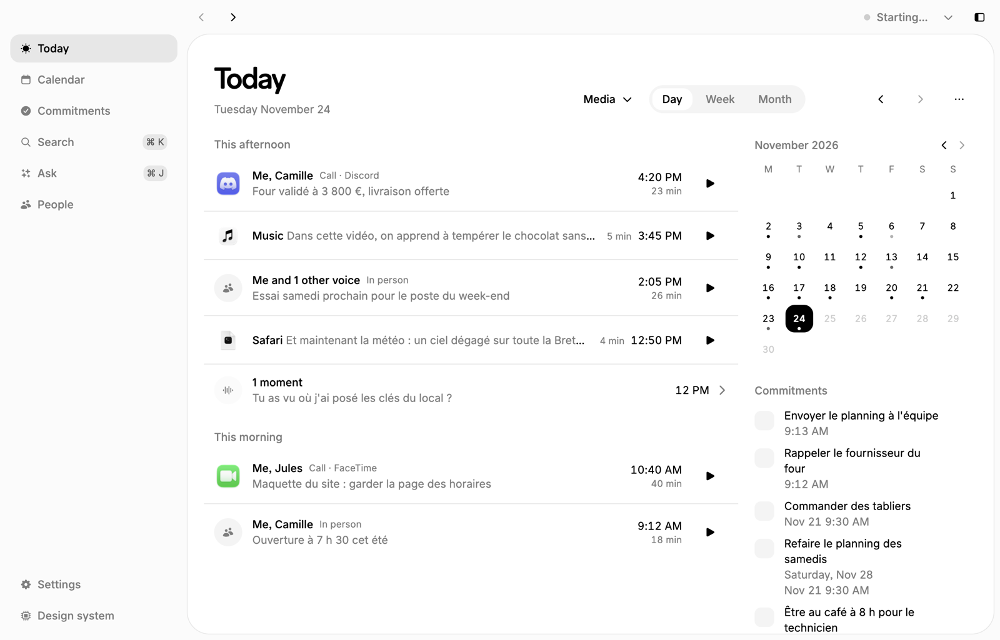
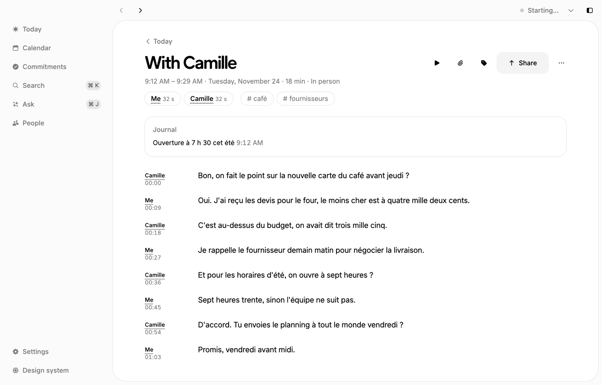

# Sondine

Sondine is an always-on auditory memory for macOS. It listens to every audio
source on your Mac (the microphone, calls, videos, meetings), turns speech
into searchable conversations with their voices told apart, and by default keeps
everything on your own devices. An iPhone companion records by hand and hands
its recordings to the Mac.





The captures show invented data.

## What it does

- **Captures** every input device and the Mac's own audio, credited to the
  app (or the browser tab) that played it.
- **Transcribes** French and English, and separates the voices. Name them, and
  after a few confirmed examples Sondine suggests or recognizes them in later
  conversations.
- **Groups** speech into conversations and short moments, with a daily
  journal and the commitments people made.
- **Searches** everything: words, people, apps, days and your own tags.
- **Exports** a conversation as Markdown, subtitles or JSON, and lets an
  agent read your memory through a local MCP server, off by default and
  read-only.

## Privacy

Sondine is local by default: audio, transcripts and voices stay on your
devices, and there is no Sondine account. The Mac app reaches the network only
for what you turn on or ask for:

- downloading a model you chose, from Hugging Face;
- checking for a new version on this project's GitHub releases, when you ask;
  with your yes to one question, also downloading and installing it by itself,
  signed and notarized versions only;
- syncing with an iPhone you paired, on your local network, or through
  Tailscale once you allow it;
- a discussion with an agent, or a journal written or checked by one, through
  your own Claude Code and your own subscription: what the agent reads goes to
  Anthropic, under the terms of your plan. The journal is written by a local
  model unless you choose Claude;
- transcription on another machine: the audio of finished conversations,
  voices and spoken names included, goes sealed to a computer of yours, or to
  a small beta server of Synapsr's, and the text comes back. Whoever
  administers that machine can technically reach both while it works on them.
  So the beta is **not** zero data retention towards us: we give our word not
  to read or listen, nothing proves it to your Mac;
- anonymous statistics, once you said yes: one report of counts for each day
  Sondine ran, with no content, name, hour or identifier of you or your Mac
  ([what is in it](docs/analytics.md)).

Agents you connect to Sondine's local MCP server read your memory and may
forward it the same way; that server is off until you enable it.

[docs/network.md](docs/network.md) lists everything that leaves, to whom, and
what they keep; the rules and their reasons are in
[ADR 002](docs/decisions/002-local-only.md).

## Download

Get the notarized disk image from the
[latest release](https://github.com/teo-goulois/sondine-releases/releases/latest).
From there it keeps itself up to date, if you say yes to its question. Without
that yes it downloads nothing: look for a new version in Settings.

Requirements:

- a Mac with Apple Silicon and macOS 27;
- 32 GB of memory to transcribe on the Mac, the only size Sondine was measured
  and tested on.

With less memory, another machine can do the final transcription: a Linux PC
with an NVIDIA card and 32 GB of RAM
([how](docs/cloud/en/using-your-own-server.md)). This was measured from a 32 GB
Mac with an RTX 5080; Sondine has not been tried yet on a Mac with less.
Near-live text asks for 8 GB and the local journal for 16 GB, both measured on
32 GB only. The beta server has a few places: when they are taken, the app
says so.

The iPhone app is in a private TestFlight beta.

## Build from source

You need Node 24.11 or later, pnpm 12, and Xcode with Swift 6.4 for the
native parts.

```bash
pnpm install        # also downloads Electron
pnpm check          # lint, format, typecheck and tests
native/scripts/fetch-models.sh
(cd native && swift build -c release && swift build)   # helpers, then the debug relays
pnpm dev            # the desktop app in development
```

A build without Apple's Developer ID for this project packages the app but
does not capture audio; capture work runs in development. See
[CONTRIBUTING.md](CONTRIBUTING.md) for the details, and
[docs/architecture.md](docs/architecture.md) for how the pieces fit.

## License

Sondine is free software under the
[GNU Affero General Public License v3.0](LICENSE). [NOTICE](NOTICE) lists the
third-party assets that keep their own licenses (Nucleo icons, the Allo
font) and the additional permission that covers them. Model weights are never
in this repository; each model keeps its own license.
